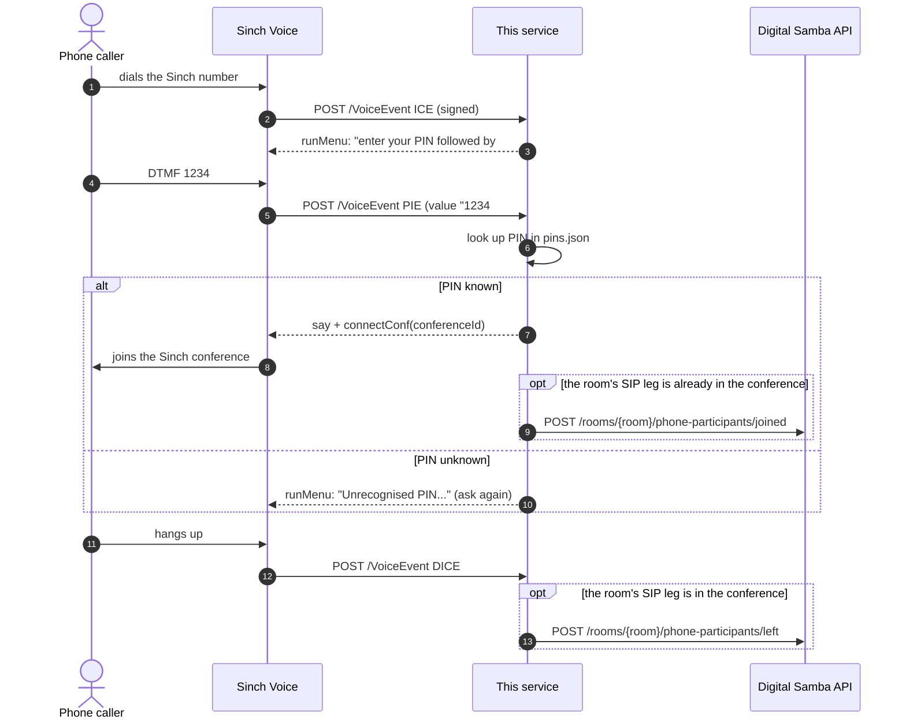
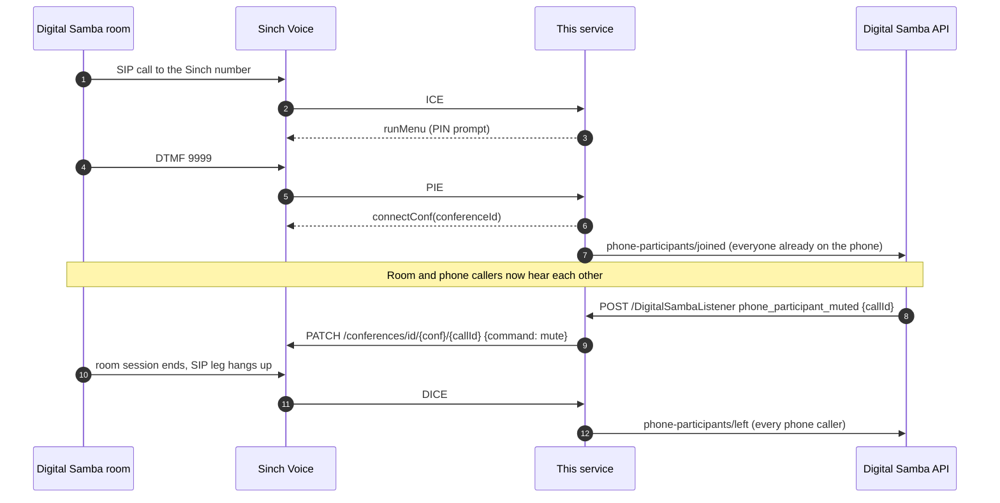

# Sinch Conference Middleware

A small reference sample showing how to let people **dial into a [Digital Samba](https://www.digitalsamba.com) video room from an ordinary phone**, using [Sinch Voice](https://developers.sinch.com/docs/voice) conferences as the phone side.

Phone callers dial a Sinch number and type a PIN. The Digital Samba (DS) room dials the same number over SIP with its own PIN. Both land in the same Sinch conference, so they can hear each other. This service sits in the middle and:

- answers Sinch's call callbacks: asks for the PIN, then puts the caller in the right conference;
- tells the DS room which phone participants are present, so they show up in the participant list;
- relays mute/unmute from the DS room to the caller's phone leg.

It is about 330 lines of JavaScript (430 with comments) in six small files. The code is meant to be read: start with [`src/callFlow.js`](sinch-ds/src/callFlow.js).

## Why you would use it

- You already use Digital Samba and want phone dial-in that you control: your own numbers, PINs and Sinch account.
- You want a working, tested starting point to copy, not a product. Persistence, PIN management and multi-tenant concerns are left to you on purpose (see [Limitations](#limitations)).

## How it works

### A phone caller dials in



### The Digital Samba room joins (its SIP leg)

The room joins exactly like a caller: it dials the Sinch number over SIP and sends its PIN as DTMF after answer (for example `WWW9999#`, where each `W` is a short pause). What makes it special is its PIN entry: a `displayName` starting with **`SIP`**.



Phone callers are only "in the room" while the room's SIP leg is in the conference, so DS is told about them only then. DS notifications are sent in the background: a slow DS API never delays a caller getting into the conference.

### Code map

| File | What it does |
|------|--------------|
| [`src/callFlow.js`](sinch-ds/src/callFlow.js) | ICE / PIE / DICE handling and the in-memory call state. Start here. |
| [`src/sinch.js`](sinch-ds/src/sinch.js) | Callback signature check, the SVAML responses, mute/unmute API calls |
| [`src/digitalSamba.js`](sinch-ds/src/digitalSamba.js) | DS phone-participants joined/left API calls |
| [`src/config.js`](sinch-ds/src/config.js) | Environment variables and the PIN map, validated at startup |
| [`src/app.js`](sinch-ds/src/app.js) | The three HTTP routes |
| [`src/server.js`](sinch-ds/src/server.js) | Entry point |

## Prerequisites

- **Node.js 24 LTS** (22.13 or later works) and npm, or Docker.
- **A Sinch account** with:
  - a **Voice app** (Sinch dashboard → Voice → Apps). Note its **application key** and **secret**;
  - a **phone number** assigned to that app;
  - the app's **callback URL** set to `https://<your-host>/VoiceEvent`. Sinch must reach it over public HTTPS. Locally, use a tunnel (see below).
- **A Digital Samba team** with:
  - a **developer key** (team settings → Developer);
  - **telephony enabled** for the team. Ask Digital Samba support if you do not see phone/telephony settings on your rooms;
  - a **room** whose telephony settings dial the Sinch number and send the SIP leg's PIN as DTMF (e.g. `WWW9999#`). Put that room's ID in the PIN map as `dsRoomId`;
  - a **webhook** (dashboard, or `POST /api/v1/webhooks`) that sends `phone_participant_muted` and `phone_participant_unmuted` to `https://<your-host>/DigitalSambaListener`, with the authorization header set to `Bearer <DIGITAL_SAMBA_WEBHOOK_SECRET>`.

## Configuration

### Environment variables

Copy [`sinch-ds/.env.sample`](sinch-ds/.env.sample) to `sinch-ds/.env`. The service checks everything at startup and refuses to start, listing every problem, if something is missing or wrong.

| Variable | Required | Default | Purpose |
|----------|----------|---------|---------|
| `SINCH_APPLICATION_KEY` | yes | | Verifies callback signatures; authenticates Calling API calls |
| `SINCH_APPLICATION_SECRET` | yes | | As above |
| `SINCH_REGION` | no | `europe` | Calling API region: `global`, `europe`, `northAmerica`, `southAmerica`, `asiaSouthEast1`, `asiaSouthEast2`. Must match where your conferences are hosted |
| `DIGITAL_SAMBA_DEVELOPER_KEY` | if any PIN has a `dsRoomId` | | Bearer token for the DS REST API |
| `DIGITAL_SAMBA_API_URL` | no | `https://api.digitalsamba.com` | DS API base URL |
| `DIGITAL_SAMBA_WEBHOOK_SECRET` | yes | | Shared secret DS sends as `Authorization: Bearer <secret>`. Generate with `openssl rand -hex 32` |
| `SEND_CALLER_NUMBER` | no | `false` | `true` sends callers' phone numbers to DS (shown in the room). Off by default: they are personal data |
| `PIN_MAP_FILE` | no | `pins.json` (Docker: `/config/pins.json`) | Path to the PIN map |
| `PORT` | no | `3030` | HTTP port |
| `ALLOW_INSECURE_DEV` | no | | `true` lets the service start without `DIGITAL_SAMBA_WEBHOOK_SECRET`, leaving `/DigitalSambaListener` open. Local experiments only |

### The PIN map

A JSON object keyed by PIN. Start from [`sinch-ds/pins.example.json`](sinch-ds/pins.example.json):

```json
{
  "1234": { "conferenceId": "demo-conference", "displayName": "Alice (phone)", "externalId": "crm-42" },
  "9999": { "conferenceId": "demo-conference", "displayName": "SIP Room Bridge", "dsRoomId": "<DS room ID>" }
}
```

| Field | Required | Meaning |
|-------|----------|---------|
| key (the PIN) | yes | 1-6 digits, no leading zero. Callers type it followed by `#` (a caller typing `01234` matches `1234`) |
| `conferenceId` | yes | Sinch conference to join (max 64 characters). Sinch creates it on first join |
| `displayName` | yes | Name shown in the DS room. **A name starting with `SIP` marks the DS room's own leg** |
| `externalId` | no | Passed to DS as `external_id` |
| `dsRoomId` | no | DS room linked to this conference. Set it on at least one entry per conference (usually the `SIP` one). Entries for the same conference must not disagree |

PINs are dial-in credentials: keep `pins.json` out of git (it is ignored) and readable only by the service.

## Run locally

```bash
cd sinch-ds
npm ci
cp .env.sample .env                  # fill it in
cp pins.example.json pins.json       # your PINs and DS room ID
npm start                            # listens on :3030, loads .env if present

# in another terminal: give Sinch a public HTTPS URL
cloudflared tunnel --url http://localhost:3030     # or: ngrok http 3030
```

Set the Sinch app's callback URL to `https://<tunnel-host>/VoiceEvent` and the DS webhook to `https://<tunnel-host>/DigitalSambaListener`, then call your Sinch number.

```bash
npm test      # node:test; Sinch callbacks are signed with the Sinch SDK's own signer
npm run lint
```

## Run in Docker

```bash
docker build -t sinch-ds ./sinch-ds
docker run -d --name sinch-ds --restart unless-stopped \
  --env-file sinch-ds/.env \
  -v "$PWD/sinch-ds/pins.json:/config/pins.json:ro" \
  -p 127.0.0.1:3030:3030 \
  sinch-ds
```

Or `docker compose up -d --build` from the repository root (same thing, see [`compose.yaml`](compose.yaml)). The image runs as an unprivileged user (uid 1000), so on Linux `pins.json` must be readable by uid 1000. Publish the port on loopback only and put a tunnel or TLS reverse proxy in front.

## Deployment (GitHub Actions)

- [`ci.yml`](.github/workflows/ci.yml), on every PR and push to `main`: `npm ci`, lint, tests, `npm audit --omit=dev --audit-level=high`. Then it builds the image, checks it refuses to start without the webhook secret, and checks it turns healthy with the example PIN map.
- [`main.yml`](.github/workflows/main.yml), push to `main`: CI, push `digitalsamba376/sinch-ds:latest`, deploy `sinch-ds-dev` over SSH.
- [`production.yml`](.github/workflows/production.yml), tag `X.Y.Z`: the same with `sinch-ds:X.Y.Z` as `sinch-ds-prod`.

The deploy joins the container to the `deployment_proxy` network behind nginx-proxy (`VIRTUAL_HOST` / `LETSENCRYPT_HOST`) and **publishes no host port**. Secrets go into a `0600` env file on the host, never onto a command line. The PIN map is written `0400` for uid 1000 and mounted read-only. The deploy fails, printing the container's last log lines, if the container does not turn healthy.

Secrets per GitHub environment (`development`, `production`):

- `SINCH_APPLICATION_KEY`, `SINCH_APPLICATION_SECRET`, `SINCH_REGION` (optional)
- `DIGITAL_SAMBA_DEVELOPER_KEY`, `DIGITAL_SAMBA_WEBHOOK_SECRET`, `DIGITAL_SAMBA_API_URL` (optional), `SEND_CALLER_NUMBER` (optional)
- `PIN_MAP_JSON_B64`: `base64 < pins.json`. Optional if `<DEPLOYMENT_PATH>/pins.json` already exists on the host
- `SERVER_HOST`, `SERVER_USER`, `SERVER_SSH_KEY`, `DEV_HOST` / `PRODUCTION_HOST`, `DEPLOYMENT_PATH` (optional)
- `DOCKER_HUB_USERNAME`, `DOCKER_HUB_TOKEN`

## Security notes

- **`/VoiceEvent` accepts only callbacks signed by Sinch** with your application key and secret. A signed callback whose `x-timestamp` is more than 15 minutes off is rejected as a replay.
- **`/DigitalSambaListener` requires the shared secret**, compared in constant time. There is no default: the service will not start without one unless you set `ALLOW_INSECURE_DEV=true`.
- **No admin surface, by design.** There is no UI, management API or live log. Anything that lists PINs or live calls over HTTP is something to attack. PINs change by editing `pins.json` and restarting.
- **Logs stay minimal:** no headers, request bodies or PINs. Caller numbers are masked (`+49…1234`).
- **Never commit `.env` or `pins.json`.** Both are git-ignored and kept out of the Docker build context.

## Troubleshooting

| Symptom | Likely cause |
|---------|--------------|
| Service exits at startup with "Refusing to start" | Read the list it prints: a missing variable, a malformed `pins.json`, or `dsRoomId` without `DIGITAL_SAMBA_DEVELOPER_KEY` |
| Caller hears nothing; logs show `Rejected /VoiceEvent` | Wrong key or secret, a server clock more than 15 minutes off, or a proxy that changes the path or body. The signature covers the path `/VoiceEvent` and the exact body bytes |
| No `ICE` lines in the log at all | Callback URL not set on the Sinch app, the number not assigned to the app, or the tunnel/proxy not reaching port 3030 |
| "Unrecognised PIN" for a PIN you configured | The PIN has a leading zero or more than 6 digits (refused at startup), or the caller did not finish with `#` before the 30-second timeout |
| Phone callers in the conference but not in the DS room | The room's SIP leg is not in the conference (its `displayName` must start with `SIP`), there is no `dsRoomId` for that conference, or the DS call failed (look for `Digital Samba notification ... failed`) |
| Muting in the DS room does nothing | DS webhook not configured or wrong secret (401), or the call is unknown to this instance (404, e.g. after a restart) |
| Mute returns 502 | Sinch rejected the command: check `SINCH_REGION` matches where the conference lives |

## Limitations

- **Call state is in memory.** After a restart, calls already in a conference keep their audio, but this instance no longer knows them: their mute and leave events are not relayed. Run a single instance.
- **PINs live in a file** and change on restart. There is no per-meeting or expiring PIN, no PIN attempt limit, and no PIN management API.
- Only `phone_participant_muted` / `phone_participant_unmuted` are acted on. Other DS events are acknowledged and ignored.
- If one conference has several `SIP` legs, they are not told apart.

## History

This repository used to contain a fuller application with a web UI, an admin REST API, a SQLite database and a WebSocket live log. A hardened version of it (upgraded dependencies, authentication on every route, tests) is on the branch [`deps-and-hardening-2026-10`](https://github.com/digitalsamba/sinch-conference-middleware/tree/deps-and-hardening-2026-10). This sample deliberately leaves all of that out.

## License

[MIT](LICENSE)
